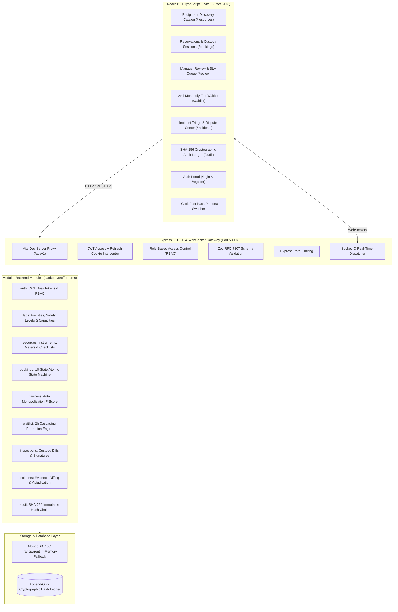
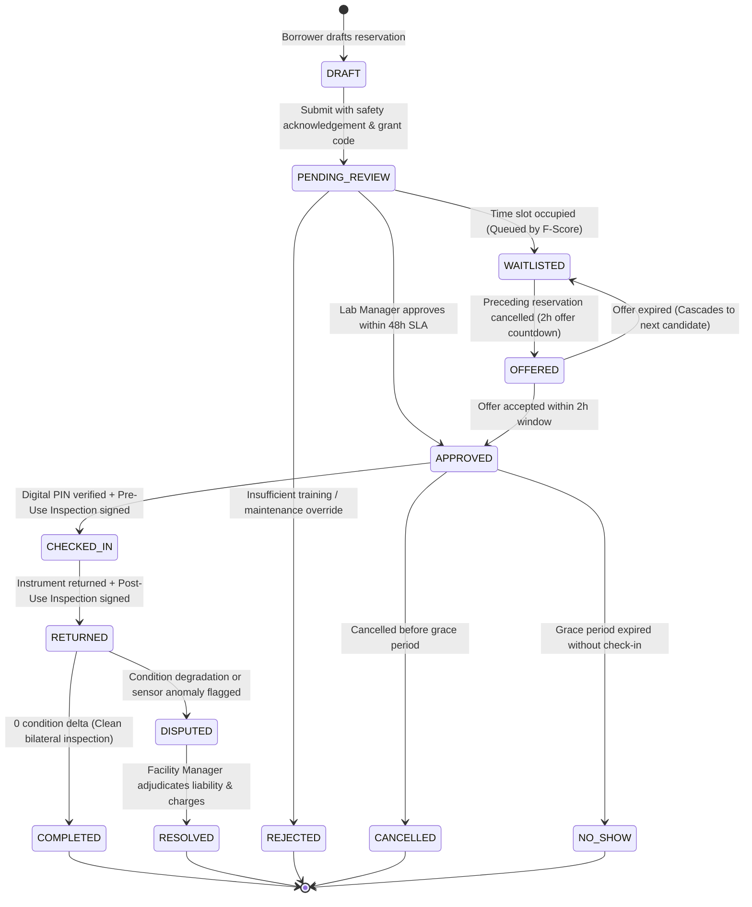

# UniShare Labs — Institutional Research Equipment & Cleanroom Sharing Platform

[](https://www.typescriptlang.org/)
[](https://nodejs.org/)
[](https://expressjs.com/)
[](https://react.dev/)
[](https://vitejs.dev/)
[](https://mongoosejs.com/)
[](https://socket.io/)
[](https://tailwindcss.com/)

**UniShare Labs** is a full-stack institutional equipment, cleanroom, and makerspace resource-sharing platform built for research universities, national laboratories, and multi-department facilities.

The platform eliminates the bottlenecks of underutilized multi-million-dollar scientific instrumentation (electron microscopes, cleanroom photolithography bays, 600 MHz NMR spectrometers, 5-axis CNC machining centers, and industrial metal 3D printers) through a **deterministic 7-gate safety eligibility engine**, **atomic half-open interval booking concurrency**, **anti-monopoly fair allocation ($F$-Formula)**, **digital PIN custody handovers**, **automated sensor condition diffing**, **bilateral dispute resolution**, and an **immutable SHA-256 cryptographic audit ledger**.

---

## Table of Contents
1. [System Architecture](#system-architecture)
2. [10-Step Resource Sharing Lifecycle](#10-step-resource-sharing-lifecycle)
3. [Core Technical Innovations](#core-technical-innovations)
4. [High-Fidelity Simulation Dataset](#high-fidelity-simulation-dataset)
5. [Evaluation Personas & 1-Click Fast Pass](#evaluation-personas--1-click-fast-pass)
6. [Monorepo Structure](#monorepo-structure)
7. [Getting Started & Quick Start Guide](#getting-started--quick-start-guide)
8. [Available Scripts](#available-scripts)
9. [API & Frontend Route Matrix](#api--frontend-route-matrix)
10. [Verification & Quality Assurance](#verification--quality-assurance)

---

## System Architecture

The project is structured as a **Feature-Based Modular Monolith** using strict TypeScript end-to-end:



---

## 10-Step Resource Sharing Lifecycle

The platform governs shared scientific equipment using a rigorous 10-state deterministic state machine:



1. **Step 1 — Discovery & Specifications**: Borrower reviews instrument capabilities, hazard levels, operating hours, and prerequisite safety requirements.
2. **Step 2 — Deterministic 7-Gate Eligibility**: Real-time evaluation of role, certifications, safety courses, inductions, supervisor endorsements, active penalties, and weekly quotas.
3. **Step 3 — Atomic Reservation**: Half-open interval conflict detection ($[A_s, A_e) \cap [B_s, B_e) = \emptyset$) with duplicate-prevention idempotency.
4. **Step 4 — Manager Review & 48h SLA**: Facility managers review applicant research proposals, NSF/NIH grant billing codes, and trust metrics.
5. **Step 5 — Approval & PIN Generation**: System allocates a secure 4-digit digital check-in access PIN and schedules buffer windows.
6. **Step 6 — Fair Waitlist Escalation**: High-demand slots automatically queue applicants by calculated $F$-Scores, cascading 2-hour offer windows on cancellations.
7. **Step 7 — Digital Custody Check-In**: Borrower confirms baseline meter telemetry (laser run-hours, chamber vacuum, cryo-temperature) and signs a SHA-256 digital custody agreement.
8. **Step 8 — Post-Use Return & Condition Diffing**: Post-session meter readings calculate exact usage deltas ($\Delta \text{Meters}$, $\Delta \text{Condition}$).
9. **Step 9 — Bilateral Dispute Adjudication**: Damage or time overruns automatically triage into incident tickets supporting photographic evidence, defense statements, and manager rulings.
10. **Step 10 — SHA-256 Audit Trail**: Every lifecycle mutation is appended to an unbroken cryptographic hash-chain ($H_n = \text{SHA256}(H_{n-1} + \dots)$) verifiable in real-time.

---

## Core Technical Innovations

### 1. Deterministic 7-Gate Safety Eligibility Engine
Prevents unqualified personnel from operating hazardous equipment (Class 4 lasers, high-voltage electron beams, toxic cleanroom reactive gases).
- **Gate 1**: Minimum Institutional Role check.
- **Gate 2**: Mandatory Certification validity and expiration check.
- **Gate 3**: Departmental Safety Training compliance (`SAFETY-101`, `HAZMAT-101`, `RADIATION-201`, `CRYO-101`).
- **Gate 4**: Facility Physical Induction verification.
- **Gate 5**: Principal Investigator / Supervisor Endorsement.
- **Gate 6**: Active Penalty Points threshold (suspension on $\ge 30$ points).
- **Gate 7**: Weekly Usage Quota headroom check.

### 2. Atomic Half-Open Interval Booking Concurrency
Eliminates double-booking bugs and race conditions through atomic MongoDB transactional checks:
$$\text{Conflict} \iff \max(A_s, B_s) < \min(A_e, B_e)$$
Includes configurable instrument turnaround buffers and post-use maintenance cooldown intervals.

### 3. Anti-Monopolization Fair Queue ($F$-Formula)
To prevent well-funded research groups from monopolizing premier instruments, waitlist priority is calculated dynamically using the multi-factor $F$-Formula:
$$F = 0.35 \cdot S_{\text{history}} + 0.20 \cdot S_{\text{cancellations}} + 0.25 \cdot S_{\text{reputation}} + 0.20 \cdot S_{\text{waitlist}}$$
- **$S_{\text{history}}$**: Penalizes excessive recent usage; rewards infrequent users.
- **$S_{\text{cancellations}}$**: Incentivizes low cancellation and zero no-show rates.
- **$S_{\text{reputation}}$**: Rewards stellar custody ratings and zero incident penalties.
- **$S_{\text{waitlist}}$**: Logarithmic reward for time spent queued.

### 4. Bilateral Custody Handover & Sensor Condition Diffing
Physical instrumentation custody is tracked through paired inspections:
- **Baseline Check-In**: Pre-use dial inspection, camera upload with SHA-256 hashes, and digital signature.
- **Return Handover**: Post-use readings compute incremental metrics ($\Delta$ Laser hours, $\Delta$ Spindle cycles, $\Delta$ Run time).
- **Condition Diff Engine**: Evaluates rating drops (e.g. `EXCELLENT` $\rightarrow$ `DAMAGED`) and automatically opens an incident ticket when an anomaly is detected.

### 5. Cryptographic SHA-256 Audit Trail
- Every transaction is hashed into an immutable append-only ledger:
$$H_n = \text{SHA-256}(H_{n-1} \parallel \text{action} \parallel \text{actorId} \parallel \text{timestamp} \parallel \text{payloadHash})$$
- Canonical JSON key sorting guarantees identical payload hashing regardless of platform.
- **Live Verifier**: Evaluators can click **"Verify Hash Chain"** on `/audit` to verify 100% chain continuity from the Genesis block to current tip.

---

## High-Fidelity Simulation Dataset

The repository includes a comprehensive dataset populated by [`backend/src/database/seed.ts`](file:///d:/hackathon/backend/src/database/seed.ts) using `@faker-js/faker`:

```
================ SEED SUMMARY ================
Users:        36 academic profiles (5 fixed core personas + 31 Faker academics)
Labs:         6 multi-department research facilities
Resources:    28 advanced research instruments
Bookings:     64 spanning all 10 lifecycle states
Inspections:  35 bilateral check-in & return records with sensor meters
Incidents:    6 realistic dispute tickets & adjudications
Audit Ledger: 89 cryptographically chained blocks
Chain Status: VERIFIED (100% Cryptographically Intact)
==============================================
```

### Facilities Seeded
1. **Nanotech Cleanroom & Microfabrication Core** (`LAB-NANO-01`, ISO Class 5/6, Engineering Hall B)
2. **Advanced Electron Microscopy & Imaging Center** (`LAB-AEMC-02`, Vibration-isolated suite, Physical Sciences)
3. **Robotics & Advanced Prototyping Makerspace** (`LAB-ROBOT-03`, Innovation Pavilion)
4. **Bio-Spectrometry & Nuclear Magnetic Resonance Lab** (`LAB-BIOSPEC-04`, Life Sciences Institute)
5. **Quantum Optics & Ultrafast Laser Facility** (`LAB-QOPT-05`, Photonics Research Tower)
6. **Precision Heavy Machining & Waterjet Facility** (`LAB-PREC-06`, Heavy Engineering Annex)

### Scientific Instruments Seeded
- **Microscopes**: DualBeam SEM/FIB, Aberration-Corrected TEM, Asylum AFM, Zeiss LSM 980 Airyscan 2 Confocal, Leica STED Nanoscopy.
- **Cleanrooms**: Direct-Write Laser Lithography, ICP-Etcher, Contact Mask Aligner, E-Beam Evaporator, Atomic Layer Deposition (ALD), Stylus Profilometer.
- **Spectrometers**: 600 MHz Cryoprobe NMR, Q-TOF LC/MS, FTIR ATR, Confocal Raman Microscope, Powder XRD, DLS Zetasizer.
- **CNC Machining**: Haas VF-2SS 5-Axis Super-Speed Mill, Datron M8Cube (60,000 RPM), OMAX 50,000 PSI Waterjet, Tormach 4-Axis Mill.
- **3D Printers**: EOS M 290 DMLS (Titanium/Inconel), Formlabs Form 4B SLA, Stratasys Fortus 450mc (ULTEM), Markforged Continuous Carbon Fiber.
- **General Lab**: 100,000 RPM Ultracentrifuge, -84°C Cascade Freeze Dryer, 14T Cryofree Superconducting Magnet.

---

## Evaluation Personas & 1-Click Fast Pass

To facilitate grading and review, 5 core personas are configured with the fixed password `Password123!`.

A floating **Role Switcher** widget at the bottom right and in the top navigation bar allows instantaneous switching between personas without typing credentials:

| Persona Name | Role | Email | Password | Department | Trust Score | Weekly Quota |
|---|---|---|---|---|---|---|
| **Alex Mercer** | `STUDENT` | `student@university.edu` | `Password123!` | Physics | 88 | 12 hrs/wk |
| **Dr. Elena Rostova** | `RESEARCHER` | `researcher@university.edu` | `Password123!` | Materials Science | 94 | 25 hrs/wk |
| **Prof. Marcus Vance** | `RESOURCE_OWNER` | `owner@university.edu` | `Password123!` | Physics | 98 | 40 hrs/wk |
| **Dr. Sarah Jenkins** | `LAB_MANAGER` | `manager@university.edu` | `Password123!` | Materials Science | 100 | 40 hrs/wk |
| **Arthur Pendelton** | `ADMIN` | `admin@university.edu` | `Password123!` | Central Administration | 100 | 100 hrs/wk |

> [!TIP]
> Navigating directly to [`/review`](http://localhost:5173/review) automatically initializes session context as **Lab Manager** (Dr. Sarah Jenkins), allowing immediate evaluation of the 48-hour SLA review queue.

---

## Monorepo Structure

```
d:\hackathon\
├── package.json              # Monorepo workspaces definition (backend + frontend)
├── README.md                 # Complete system documentation (this file)
│
├── backend\                  # Express 5 + TypeScript Modular Monolith
│   ├── src\
│   │   ├── features\         # Feature-based architecture
│   │   │   ├── auth\         # Dual-token JWT & RBAC user management
│   │   │   ├── labs\         # Laboratory facilities & operating schedules
│   │   │   ├── resources\    # Instruments, custom checklists & sensor meters
│   │   │   ├── bookings\     # 10-state lifecycle & atomic half-open scheduling
│   │   │   ├── fairness\     # Anti-monopoly F-Formula calculation engine
│   │   │   ├── waitlist\     # Cascading waitlist promotion & 2h countdown
│   │   │   ├── inspections\  # Bilateral check-in/return & condition diffing
│   │   │   ├── incidents\    # Photographic evidence & manager adjudications
│   │   │   └── audit\        # SHA-256 immutable ledger & chain verifier
│   │   ├── database\         # Resilient connection & Faker seeder
│   │   ├── middleware\       # Error handling, validateBody, authenticateToken
│   │   ├── app.ts            # Express application configuration
│   │   └── server.ts         # Server bootstrap, Socket.IO & seed-on-boot
│   ├── README.md             # Detailed backend architecture & API reference
│   └── package.json
│
└── frontend\                 # React 19 + TypeScript + Vite + Tailwind CSS
    ├── src\
    │   ├── components\common # Navbar, Footer, RoleSwitcher, StatusBadge, Modal
    │   ├── context\          # AuthContext (Fast Pass) & SocketContext
    │   ├── features\
    │   │   ├── catalog\      # Discovery, search & 7-gate eligibility check
    │   │   ├── bookings\     # My Bookings, PIN reveal & cancellation
    │   │   ├── handover\     # Check-in modal, return modal & condition diff
    │   │   ├── management\   # 48h SLA ReviewQueue & WaitlistManager
    │   │   ├── audit\        # DisputeCenter & AuditLedgerView
    │   │   └── auth\         # LoginPage & RegisterPage
    │   ├── services\         # Axios RFC 7807 client & Socket.IO service
    │   ├── App.tsx           # Router & console tab navigation
    │   └── main.tsx
    ├── README.md             # Detailed frontend architecture & UX walkthrough
    └── package.json
```

---

## Getting Started & Quick Start Guide

### Prerequisites
- **Node.js**: `v20.x` or `v22.x` (`node -v`)
- **npm**: `v10.x` or higher
- **MongoDB** *(Optional)*: If no external MongoDB daemon is listening on `mongodb://localhost:27017/unishare_labs`, the backend **transparently falls back to an embedded in-memory MongoDB 7.0 engine**. Zero database setup required!

### 1. Installation
Clone or navigate to the project directory:
```bash
cd d:\hackathon
npm install
```

### 2. Run in Development Mode (Live Hot-Reload)
Starts both backend and frontend concurrently:
```bash
npm run dev
```
- **Backend API**: `http://localhost:5000/api/v1`
- **Frontend Application**: `http://localhost:5173/`
- **Socket.IO Gateway**: `ws://localhost:5000`
- The database is automatically populated with the 36 Faker profiles and 89 audit blocks on boot if empty!

### 3. Run in Production Mode (Pre-built Artifacts)
```bash
npm run build
npm start
```

### 4. Standalone Database Seeding
To manually reset and re-seed the Faker academic dataset:
```bash
npm run seed
```

---

## Available Scripts

Run from the root directory:

| Command | Action |
|---|---|
| `npm run dev` | Runs backend (`tsx watch`) and frontend (`vite`) concurrently |
| `npm start` | Runs production backend and Vite preview concurrently |
| `npm run build` | Compiles backend (`tsc`) and bundles frontend (`vite build`) |
| `npm run seed` | Seeds 36 Faker users, 6 labs, 28 instruments, 64 bookings & 89 audit blocks |
| `npm test` | Runs the Vitest integration test suite |
| `npm run clean` | Deletes `dist` build artifacts in backend and frontend |

---

## API & Frontend Route Matrix

### Frontend Consoles
| Route | Console Name | Primary Purpose | Required Role |
|---|---|---|---|
| `/resources` | **Equipment Catalog** | Search, filter, check 7-gate eligibility & reserve | Any / Public |
| `/bookings` | **My Bookings** | View reservations, reveal PIN, check-in, return & diff | Borrower |
| `/review` | **Review Queue** | 48h SLA queue, trust validation, 1-click approvals | Lab Manager / Owner |
| `/waitlist` | **Fairness Waitlist** | $F$-Formula rankings, queue tenure & 2h offer acceptance | Any Borrower |
| `/incidents` | **Dispute Center** | Evidence photos, defense statements & adjudication | All (RBAC Gated) |
| `/audit` | **SHA-256 Ledger** | Append-only ledger & real-time hash chain verification | Any / Auditor |
| `/login` | **Sign In Portal** | University email login with 1-click evaluator fast pass | Public |
| `/register` | **Registration** | Academic role registry with live password criteria | Public |

### Backend REST API Endpoints
| HTTP Method | Endpoint | Description | Auth Required |
|---|---|---|---|
| `POST` | `/api/v1/auth/register` | Register new academic profile | No |
| `POST` | `/api/v1/auth/login` | Sign in with email & password | No |
| `GET` | `/api/v1/auth/demo-tokens` | Fetch pre-generated tokens for all 5 demo personas | No |
| `POST` | `/api/v1/auth/refresh-token` | Rotate refresh token for a new access token | No |
| `GET` | `/api/v1/auth/me` | Fetch active user profile, quotas & certifications | Yes (Bearer) |
| `GET` | `/api/v1/labs` | List multi-department laboratory facilities | No |
| `GET` | `/api/v1/resources` | List scientific instruments with filters & search | No |
| `GET` | `/api/v1/resources/:id/eligibility` | Evaluate deterministic 7-gate safety check | Yes (Bearer) |
| `POST` | `/api/v1/bookings` | Create reservation with half-open concurrency check | Yes (Bearer) |
| `GET` | `/api/v1/bookings` | List user reservations with status filters | Yes (Bearer) |
| `GET` | `/api/v1/bookings/review-queue` | List pending reservations in 48h manager SLA queue | Yes (Manager/Owner) |
| `PATCH` | `/api/v1/bookings/:id/approve` | Approve reservation and generate 4-digit PIN | Yes (Manager/Owner) |
| `PATCH` | `/api/v1/bookings/:id/reject` | Reject reservation with standardized reason code | Yes (Manager/Owner) |
| `POST` | `/api/v1/bookings/:id/check-in` | Submit pre-flight inspection & lock baseline | Yes (Borrower) |
| `POST` | `/api/v1/bookings/:id/return` | Submit post-use return & compute condition diff | Yes (Borrower) |
| `GET` | `/api/v1/waitlist/my-waitlists` | View waitlisted requests with $F$-Score breakdowns | Yes (Borrower) |
| `POST` | `/api/v1/bookings/:id/accept-waitlist-offer` | Claim promoted slot within 2h countdown | Yes (Borrower) |
| `GET` | `/api/v1/incidents` | List incident tickets and active disputes | Yes (Bearer) |
| `POST` | `/api/v1/incidents/:id/dispute` | File operator defense statement | Yes (Borrower) |
| `POST` | `/api/v1/incidents/:id/adjudicate` | Adjudicate incident, assign penalty & charges | Yes (Manager/Admin) |
| `GET` | `/api/v1/audit/ledger` | Fetch immutable chronological audit logs | Yes (Bearer) |
| `GET` | `/api/v1/audit/verify-chain` | Verify cryptographic SHA-256 hash-chain integrity | Yes (Bearer) |

---

## Verification & Quality Assurance

The application compiles cleanly with zero TypeScript or bundler errors:
```bash
npm run build
```
```
> unishare-backend@1.0.0 build
> tsc  # 113 files compiled with Exit Code 0

> unishare-frontend@1.0.0 build
> tsc && vite build  # 1,690 modules transformed with Exit Code 0
```

---

## License & University Attribution

Developed for university research sharing, makerspace access, and cross-departmental laboratory stewardship. Distributed under the MIT License.

